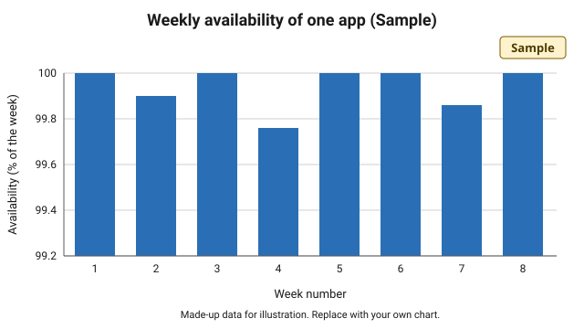

## How reliable has my ElfHosted stack been? {#by-the-numbers}

- This is sample text. Your export lists plain facts here, such as how long an app was up.
- The app was available for 99.7 percent of the time over the period shown in the chart.
- You can edit every line on this page.

## Why ElfHosted instead of self-hosting or another host?

This is a placeholder. Replace this file with the `index.md` from your ElfBot Saga export, keeping the same name. Write about what you run, what worked, what didn't, and what you'd tell someone starting out.

## What works well?

_[Your words here: What has been solid for you?]_

## What goes wrong, and how does it get fixed?

_[Your words here: What broke, and how was it sorted out?]_

_Sample chart with made-up numbers. Your export carries a chart built from your own health checks._

## What I asked Sam about

- Sample question one
- Sample question two
